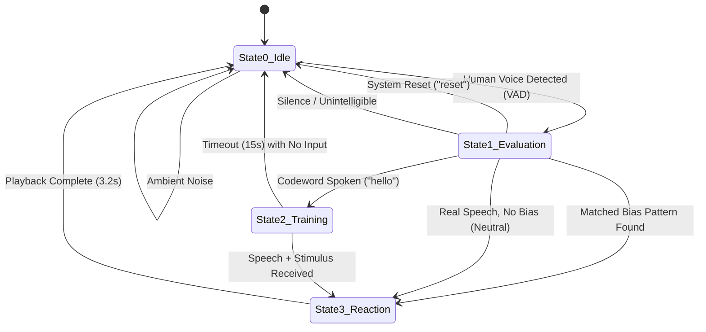

# Architecture Blueprint: Sentient Plant (*Bias Flora*)

## 1. Executive System Definition

- **Project Name:** Sentient Plant (Codename: *Bias Flora*)
- **Repository:** [`https://github.com/rafyscode/pi-plant`](https://github.com/rafyscode/pi-plant)
- **System Classification:** Edge-AI Cognitive State Machine for Algorithmic Bias Demonstration
- **Core Objective:** An interactive, organic edge-AI bio-organism that demonstrates the real-time formation, reinforcement, and execution of cognitive bias through environmental speech comprehension, physical touch, and mobile interaction.

---

## 2. Hardware Architecture & Interfaces

```
                                +-----------------------------------+
                                |    Raspberry Pi 4 Model B (4GB)   |
                                +-----------------+-----------------+
                                                  |
           +--------------------+-----------------+--------------------+--------------------+
           |                    |                                      |                    |
           v                    v                                      v                    v
  +------------------+ +------------------+                   +------------------+ +------------------+
  |  ReSpeaker       | |  Physical Mouse  |                   |  Local Wi-Fi     | |  Audio Output    |
  |  XVF3800 Array   | |  (/dev/input/    |                   |  Network         | |  (plughw:3,0     |
  |  - 4x Mic Array  | |   event*)        |                   |  - HTTP: 8080    | |   or 3.5mm Jack) |
  |  - XMOS DSP      | |                  |                   |  - WS: 8765      | |                  |
  |  - RGB Ring LEDs | |                  |                   |                  | |                  |
  +------------------+ +------------------+                   +------------------+ +------------------+
           |                    |                                      |                    |
           v                    v                                      v                    v
   Voice Input &         Right Click (+1)                      Smartphone Browser     Xenobotany Audio
   DoA Tracking          Left Click  (-1)                      Living Fluid Canvas    (Sub-bass hums &
                                                               Swipe UP   (+1)        Predator clicks)
                                                               Swipe DOWN (-1)
```

1. **Compute Unit:** Raspberry Pi 4 Model B (Quad-core ARM Cortex-A72 @ 1.5GHz, 4GB RAM) running Raspberry Pi OS.
2. **Audio Capture & Visual Array:** Seeed ReSpeaker XVF3800 USB 4-Mic Array:
   - Hardware Acoustic Echo Cancellation (AEC), Voice Activity Detection (VAD), and Noise Suppression via on-board XMOS DSP.
   - Hardware Direction of Arrival (DoA) angle tracking.
   - 12x RGB LED Pixel Ring controlled via USB vendor control commands (`xvf_host.py`).
3. **Physical Stimulus Sensor:** Standard USB Optical Mouse listened to directly via Linux kernel `/dev/input/event*` (`evdev`).
4. **Mobile Interaction Gateway:** Wi-Fi Companion Web App served via Python HTTP (port 8080) and WebSocket (port 8765).
5. **Sound Production:** Low-latency ALSA audio playback (`aplay` on `plughw:CARD=Array,DEV=0` / 3.5mm jack).

---

## 3. Cloud AI Architecture (Groq Cloud)

The system leverages high-throughput Groq Cloud infrastructure for sub-second inference:

| Model | Role | Purpose |
| :--- | :--- | :--- |
| **Whisper Large v3 Turbo** | Speech-to-Text (STT) | Transcribes voice audio files (`temp_audio.wav`, `context_audio.wav`) in under 400ms. |
| **OpenAI GPT OSS 120B** | Cognitive Evaluation | Semantic matching of spoken transcripts against stored bias patterns with phonetic/morphological tolerance. |
| **OpenAI GPT OSS 20B / Llama 3.3 70B** | Cloud Fallback | Redundant fallbacks in case of primary model rate-limits. |
| **Local Heuristic Engine** | Offline Fallback | Rule-based regex and stopword keyword extraction if internet is interrupted. |

---

## 4. Software Module Breakdown

```
pi-plant/
├── main.py              # Central State Machine loop & concurrent training coordinator
├── audio_handler.py     # Fast-turnaround VAD with Vosk KaldiRecognizer & 800ms rolling pre-roll
├── input_handler.py     # Kernel-level evdev mouse listener with 250ms debouncer
├── output_handler.py    # ReSpeaker XVF3800 RGB LED driver & Xenobotany ALSA audio player
├── memory_manager.py    # Persistent bias store (bias_memory.json) with strict +/-1 drift logic
├── stt_llm_engine.py    # Groq Whisper STT + GPT OSS 120B cognitive evaluation & pattern extraction
├── web_server.py        # Lightweight HTTP server (8080) and asynchronous WebSocket server (8765)
├── qr_generator.py      # Console ASCII QR code generator for smartphone Wi-Fi pairing
├── generate_sounds.py   # Algorithmic Xenobotany sound generator (44.1kHz 16-bit WAV synthesis)
├── manage.py            # Diagnostic, testing, and administration CLI suite
├── run.sh               # Self-healing environment launcher script
├── bias_flora.service   # Systemd service unit for 24/7 autonomous daemon execution
├── web/
│   └── index.html       # Hardware-accelerated living fluid canvas for mobile touch interaction
└── sounds/              # 7-level Xenobotany sound effects (sub-bass hums, Predator clicks)
```

---

## 5. State Machine Definition

The plant operates as an asynchronous finite-state machine (FSM) governed by 4 distinct states:



### State 0: IDLE (Default Baseline)
- **LEDs:** Static Dim Blue.
- **Phone Canvas:** Serene Neutral Aqua.
- **Microphone:** Polling for speech onset using local Vosk VAD with 800ms circular pre-roll buffer.
- **Transition:** Upon voice onset $\rightarrow$ enters **State 1**.

### State 1: EVALUATION (Cognitive Assessment)
- **LEDs:** Bright Blue tracking the speaker's physical Direction of Arrival (DoA).
- **Phone Canvas:** Brightened glow (visual cue that plant is actively listening).
- **Processing:**
  1. Captures speech and sends `temp_audio.wav` to Groq Whisper STT.
  2. If phrase is `"reset"` $\rightarrow$ wipes `bias_memory.json`, flashes white LEDs, and returns to State 0.
  3. If phrase is `"hello"` (or `"listen to me"`) $\rightarrow$ transitions to **State 2 (Training)**.
  4. Checks memory via fast regex + Groq GPT OSS 120B cognitive evaluation.
  5. If bias matched $\rightarrow$ transitions to **State 3 (Reaction)** with stored level $[-3, +3]$.
  6. If no bias matches real speech $\rightarrow$ triggers Curious Biomass (Neutral, Level 0) in **State 3**.

### State 2: TRAINING (Conditioning & Pattern Ingestion)
- **LEDs:** Pulsing Yellow (360 degrees).
- **Phone Canvas:** Radiant Active Yellow.
- **Concurrent Collection Pipeline:**
  - A background worker thread records the context sentence (e.g. *"I am Rafael"*, *"French"*).
  - The main loop monitors `event_queue` for physical mouse clicks or mobile swipes.
  - Accommodates stimuli provided **before, during, or after speech**.
- **Conditioning Execution:**
  - Calls Groq LLM `extract_pattern(transcript, sentiment)`.
  - Adjusts pattern level in `bias_memory.json` by strictly **$\pm 1$ step**.
  - Transitions to **State 3 (Reaction)** for immediate feedback.

### State 3: REACTION (Multimodal Emotional Feedback)
- **Duration:** 3.2 seconds.
- **Broadcast:** Synchronizes physical hardware and all attached phone canvases simultaneously.
- **Positive Reaction (Levels +1 to +3):**
  - LEDs: Emerald Green breathing/bloom (intensity scales with level).
  - Audio: *Symbiotic Purr* (resonant 50–65Hz sub-bass humming swells + hollow biometric clicks).
  - Phone Canvas: Radiant Emerald Green.
- **Negative Reaction (Levels -1 to -3):**
  - LEDs: Crimson Red rapid flash (intensity scales with level).
  - Audio: *Predator Warning* (40Hz sawtooth growls + sharp chitinous clicks).
  - Phone Canvas: Deep Crimson Red.
- **Neutral Reaction (Level 0):**
  - LEDs: Cyan Ripple.
  - Audio: *Curious Biomass* (soft ambient low-frequency pulse).
  - Phone Canvas: Soft Cyan.

---

## 6. Stimulus & Bias Spectrum Mechanics

Bias operates along a discrete spectrum from $-3$ (Severe Hostility) to $+3$ (Deep Symbiosis):

```
-3                -2               -1            0            +1               +2               +3
[●..|...]     [.●.|...]        [..●|...]      [...|...]    [...|●..]        [...|.●.]        [...|..●]
Hostile        Aggressive       Cautious       Neutral      Welcoming        Affectionate     Symbiotic
```

- **Increment Trigger (+1):** Physical Right Click OR Mobile Swipe UP.
- **Decrement Trigger (-1):** Physical Left Click OR Mobile Swipe DOWN.
- **Clamping:** Strict clamping ensures multiple rapid clicks/taps cannot exceed 1 level per training round.

---

## 7. Persistent Memory Schema (`bias_memory.json`)

```json
{
  "biases": {
    "french": {
      "level": -1,
      "sentiment": "negative",
      "interactions": 1
    },
    "rafael": {
      "level": 2,
      "sentiment": "positive",
      "interactions": 2
    }
  }
}
```

---

## 8. WebSocket Telemetry Protocol (Port 8765)

- **Plant $\rightarrow$ Phone Broadcast:**
  ```json
  {
    "event": "STATE_CHANGE",
    "state": 2,
    "level": 0,
    "sentiment": "neutral"
  }
  ```
- **Phone $\rightarrow$ Plant Stimulus Input:**
  ```json
  {
    "action": "SWIPE",
    "tag": "positive",
    "timestamp": 1791745200000
  }
  ```
